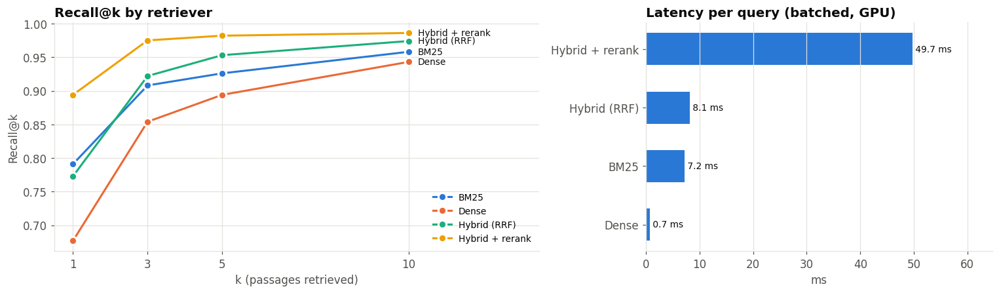
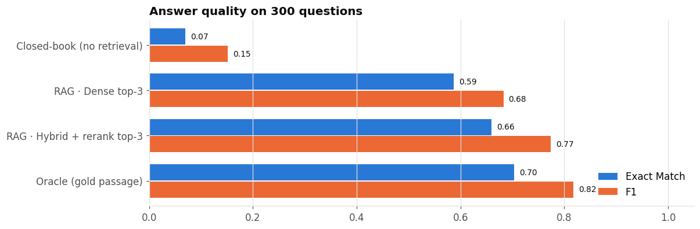

# Retrieval-Augmented Question Answering (RAG) · open-source stack

[](https://colab.research.google.com/github/ahmedbouzidi304/rag-question-answering/blob/main/rag_question_answering.ipynb)
   

A complete RAG system built and **measured** stage by stage: four retrievers are benchmarked, then an open LLM answers questions with and without retrieval, and every error is attributed to either the retriever or the generator. No API keys: everything runs on a free Colab T4 GPU.

## Architecture
```
question ──► BM25 (sparse) ──┐
         └─► bge-small + FAISS (dense) ─► Reciprocal Rank Fusion ─► cross-encoder re-rank ─► top-3 passages
                                                                                              │
                                                       Qwen2.5-1.5B-Instruct (grounded prompt) ◄┘ ─► answer + sources
```

## Pipeline
| Step | What is done |
|---|---|
| 1. Knowledge base | 2,000+ Wikipedia paragraphs from SQuAD v1.1 (validation), with gold question → passage labels |
| 2. Evaluation design | seeded sample: 1,000 questions for retrieval, 300 for generation |
| 3. Sparse retrieval | BM25 with custom tokenizer |
| 4. Dense retrieval | `BAAI/bge-small-en-v1.5` embeddings in a FAISS inner-product index |
| 5. Hybrid | Reciprocal Rank Fusion of BM25 + dense |
| 6. Re-ranking | `cross-encoder/ms-marco-MiniLM-L-6-v2` over the top-20 candidates |
| 7. Retrieval benchmark | Recall@1/3/5/10, MRR@10, latency |
| 8. Generation | `Qwen/Qwen2.5-1.5B-Instruct`, extractive prompt with abstention, batched greedy decoding |
| 9. End-to-end eval | closed-book vs RAG vs oracle, official SQuAD Exact Match / F1 |
| 10. Error analysis | retrieval failure vs generation failure, with examples |
| 11. Demo | `ask()` returns the answer with cited sources, and abstains on out-of-scope questions |

## Results
**Retrieval** (1,000 questions, 2,067 passages)

| Retriever | Recall@1 | Recall@3 | Recall@10 | MRR@10 | ms/query |
|---|---|---|---|---|---|
| BM25 | 0.791 | 0.908 | 0.958 | 0.853 | 7.2 |
| Dense (bge-small + FAISS) | 0.677 | 0.854 | 0.943 | 0.772 | 0.7 |
| Hybrid (RRF) | 0.773 | 0.922 | 0.974 | 0.851 | 8.1 |
| **Hybrid + cross-encoder re-rank** | **0.894** | **0.975** | **0.986** | **0.933** | 49.7 |

**End-to-end answers** (300 questions, Qwen2.5-1.5B-Instruct)

| Setting | Exact Match | F1 |
|---|---|---|
| Closed-book (no retrieval) | 0.070 | 0.151 |
| RAG · dense top-3 | 0.587 | 0.683 |
| **RAG · hybrid + re-rank top-3** | **0.660** | **0.774** |
| Oracle (gold passage) | 0.703 | 0.817 |

**Key findings**
- Retrieval multiplies answer quality by ~10x for a small LLM, and the best pipeline gets within 4 EM points of the oracle ceiling.
- Re-ranking is the single most effective component (+10 points Recall@1 over hybrid).
- After re-ranking, only **0.7%** of errors come from retrieval: the generator is now the bottleneck.
- The system answers with cited sources in ~0.3 s and replies `unknown` to out-of-scope questions.

<p align="center"></p>
<p align="center"></p>

> Caveat: SQuAD questions were written while reading the passage, which favours lexical retrieval; real user queries would benefit more from dense/hybrid search.

## Run it
The notebook is committed **with all outputs** from a Colab run. It renders with styled section headers on GitHub and [nbviewer](https://nbviewer.org/github/ahmedbouzidi304/rag-question-answering/blob/main/rag_question_answering.ipynb); Colab shows the headers as plain text because it strips inline CSS.

Click **Open in Colab**, select *Runtime → Change runtime type → T4 GPU*, then *Run all* (about 10-15 minutes).

## Tech stack
Hugging Face Transformers & Datasets · sentence-transformers · FAISS · rank-bm25 · PyTorch · pandas · matplotlib
